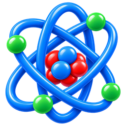

<p align="center">
  
</p>

<h1 align="center">AtomicWorld</h1>

<p align="center"><strong>De una molécula hasta sus quarks.</strong></p>

<p align="center">
  <a href="https://relativedevelopers.com/atomicworld/"><strong>🌐 Página web de AtomicWorld</strong></a>
  &nbsp;·&nbsp;
  <a href="https://relativedevelopers.com/">Relative Developers</a>
</p>

<p align="center">
  
  
  
  
</p>

---

**Una herramienta educativa para viajar de la molécula a los quarks, y de los quarks al Big Bang.**
Descompone cualquier sustancia en moles, átomos, protones, neutrones, electrones y quarks, y
explora en 3D cualquier átomo de cualquier isótopo.

> 🌐 **¿Sin instalar nada?** Úsalo directamente desde la
> [página web de AtomicWorld](https://relativedevelopers.com/atomicworld/): pulsa **«Abrir AtomicWorld»**.
> La web tiene todas las herramientas, incluido el *Átomo en 3D*, y funciona también en el móvil.
> Este repositorio es el programa para tu ordenador.

## ✨ Qué puedes hacer

### ⚛️ Tabla periódica
- **Calculadora de moléculas:** escribe una fórmula (`H2O`, `C6H12O6`, `Ca(OH)2`, `CH3COOH`…) y una
  cantidad, y AtomicWorld te dice cuántos **moles, moléculas, átomos, protones, neutrones,
  electrones y quarks** hay.
- **Los 118 elementos** con su ficha, y los **~3.500 isótopos** conocidos con su semivida y cómo se
  desintegran.
- Búsquedas en cualquier idioma: `Hierro`, `iron`, `Ferro`, `Fe` y `26` dan el mismo elemento.

### 🔭 Visor 3D: un viaje dentro del átomo
Un vuelo en primera persona con tres niveles de zoom:

| Nivel | Escala | Qué ves |
|---|---|---|
| 1 · Átomo | picómetros | la nube de electrones, capa a capa, con los orbitales p, d y f reales |
| 2 · Núcleo | femtómetros | los protones y neutrones |
| 3 · Nucleón | 0,1 fm | los quarks, el tubo de gluones y el "mar" de partículas |

Puedes moverte libremente o dejar que el **piloto automático** te lleve de un nivel al siguiente.
Hay tres modos (tecla **Tab**):

| Modo | Qué ves |
|---|---|
| **Didáctico** | colores por capa, la forma de cada orbital, protones y neutrones de colores |
| **Realista** | lo más fiel a la física: densidades, sin colores inventados |
| **Plástico 3D** | protones (+), neutrones (0), electrones (e⁻), quarks (u, d) y gluones (g) como bolas de plástico brillante. Es un modelo de juguete, y la pantalla lo explica |

### 🧪 Modelo Estándar
- **Fichas de todas las partículas**, por familias (quarks, leptones, bosones…).
- **Conversor de masas:** pasa cualquier masa entre eV/c², MeV, GeV, unidades de masa atómica, gramos
  y kilogramos, y te dice qué partícula tiene la masa más parecida.
- **Big Bang de bits:** el juego que convierte bits al azar en partículas del Modelo Estándar.

### 💥 Los tres primeros minutos
Una simulación de la **nucleosíntesis primordial**, inspirada en el libro de Steven Weinberg: sigue
al universo desde la primera centésima de segundo hasta que se forma el helio. Puedes cambiar los
parámetros (bariones por fotón, número de neutrinos, vida media del neutrón) para ver **cómo sería
el helio en otros universos**.

## 🚀 Instalación

### 1. Lo que necesitas
- **Python 3.10 o superior** ([descárgalo aquí](https://www.python.org/downloads/); en Windows,
  marca *Add Python to PATH* al instalarlo).
- **Git** ([descárgalo aquí](https://git-scm.com/downloads)), o descarga el proyecto como ZIP.

### 2. Descarga el proyecto
Abre una terminal en la carpeta donde quieras guardarlo y ejecuta:

```bash
git clone https://github.com/RelativeDevelopers/AtomicWorld.git
cd AtomicWorld
```

> También puedes descargarlo como ZIP con el botón verde **Code → Download ZIP** de GitHub.
>
> Si también vas a instalar **DNAinvent**, que usa AtomicWorld para su microscopio, guárdalo en
> `Relative_Developers/project-AtomicWorld/AtomicWorld` (ver el
> [README de DNAinvent](https://github.com/RelativeDevelopers/DNAinvent#-instalación)).

### 3. Instala las dependencias

```bash
pip install -r requirements.txt
```

**¿Solo quieres la consola, sin visor 3D?** Basta con `pip install colorama`.

### 4. ¡A explorar!

```bash
python main.py
```

La primera vez te pregunta el idioma (inglés, castellano o catalán) y lo recuerda. Se puede cambiar
con la opción **4] Language · Idioma** del menú principal, o con la tecla **L** dentro del visor.

## 🎮 Cómo se usa

### El visor 3D directamente
Se abre desde el menú (**Periodic Table → 2] Explore an atom in 3D**) o así:

```bash
python -m viewer Fe                       # hierro-56, el isótopo más abundante
python -m viewer Uranio --isotope 235     # nombre en cualquier idioma, símbolo o número
python -m viewer 6 --isotope 14 --lang ca --realistic
python -m viewer O --mode plastic         # empezar en el modo plástico 3D
```

### Controles del visor

| Tecla | Acción |
|---|---|
| **Clic** / **Esc** | capturar / soltar el ratón (Esc otra vez: salir) |
| **W A S D** · **Espacio** / **Ctrl** | moverse · subir / bajar |
| **Q** / **E** · **Shift** · **Rueda** | girar · turbo ×5 · ajustar velocidad |
| **Enter** / **Retroceso** | 🚀 piloto automático: bajar al siguiente nivel / volver al anterior |
| **N** / **P** | elemento siguiente / anterior |
| **[** / **]** | isótopo anterior / siguiente |
| **O** | ver los subniveles de uno en uno (4s → 3d → 3p…), con los ejes x, y, z |
| **I** | con un subnivel p, d o f elegido: sus orbitales de uno en uno |
| **Tab** · **Mayús + Tab** | modo: didáctico → realista → plástico 3D (y al revés) |
| **L** | cambiar idioma |
| **H** · **F11** | ayuda · pantalla completa |

## 💡 Consejos

- **¿Tienes gráfica NVIDIA en Windows?** Para que el visor vaya fluido: *Configuración → Sistema →
  Pantalla → Gráficos*, añade el `python.exe` que usas y elige **Alto rendimiento**. Al arrancar, la
  consola te dice qué tarjeta gráfica está usando.
- Los números siguen el idioma (`6,022 × 10^23` en castellano), y al escribir se aceptan tanto
  `18,5` como `18.5`.
- Tus ajustes se guardan en `~/.atomicworld/settings.json`.

## 🧠 Cuánto hay de real

AtomicWorld intenta enseñar ciencia de verdad: los orbitales tienen su forma real y se llenan según
la regla de Hund, el núcleo tiene su tamaño y densidad reales, las masas de las partículas son las
del Particle Data Group (2024) y la simulación del Big Bang da un **24,5 % de helio**, como el
observado.

También tiene sus simplificaciones: el átomo está aislado, no hay efectos relativistas, el núcleo es
una "gota líquida" y el movimiento de los quarks es una ilustración, porque en física cuántica no
tienen trayectorias.

---

## 👩‍💻 Para desarrolladores

```bash
python -m pytest            # ejecutar los tests
pip install -e .            # instalar AtomicWorld como paquete en otro proyecto
```

```python
from atomicworld import units
units.convert(0.511, "MeV", "kg")        # 9.109e-31
```

```
atomicworld/   NÚCLEO: datos y cálculos (nunca imprime ni pide datos)
ui/            consola, idiomas y ajustes
viewer/        visor 3D de escritorio
tests/         tests automáticos
tools/         scripts auxiliares (regenerar los datos, probar el visor sin ventana)
legacy/        el script original, como referencia
```

La **web** de AtomicWorld está en su propio repositorio, `AtomicWorld_web`, que usa este como
paquete de Python.

📖 **Documentación técnica completa** (la física del visor, la estructura del código, el modelo de
los tres primeros minutos, las fuentes de los datos y las correcciones respecto al original):
[docs/TECNICO.md](docs/TECNICO.md).

## 🙏 Datos y fuentes

- **Elementos e isótopos:** base de datos `mendeleev` (IUPAC/CIAAW, NUBASE).
- **Partículas:** Particle Data Group, *Review of Particle Physics* 2024.
- **Nucleosíntesis:** V. Mukhanov, *Nucleosynthesis without a computer* (2004), y Ando et al.,
  *Phys. Rev. C* 74 (2006).
- **Inspiración:** Steven Weinberg, *Los tres primeros minutos del universo*.

La lista completa está en [docs/TECNICO.md](docs/TECNICO.md#datos-y-fuentes).

---

<p align="center">
  Hecho con ⚛️ y curiosidad por <a href="https://relativedevelopers.com/">Relative Developers</a> ·
  Aplicaciones gratuitas para explorar la ciencia
</p>
